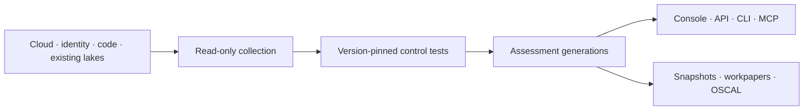
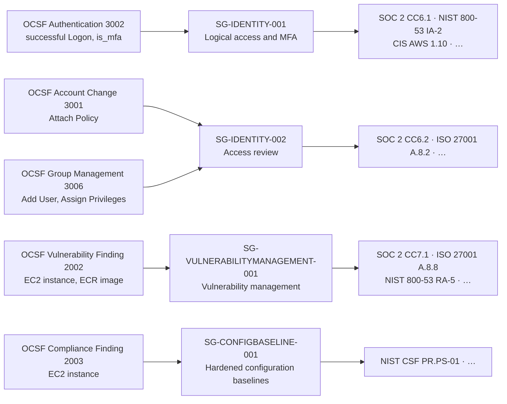

<p align="center">
  <picture>
  <source media="(max-width: 640px)" srcset="docs/images/grc-lake-capability-header-mobile.svg">
  
  </picture>

</p>

<p align="center">
  <a href="https://pypi.org/project/grc-lake/"></a>
  <a href="https://pypi.org/project/grc-lake/"></a>
  <a href="https://github.com/koda-ai-studio/grc-lake/actions/workflows/ci.yml"></a>
  <a href="LICENSE"></a>
  <a href="https://scorecard.dev/viewer/?uri=github.com/koda-ai-studio/grc-lake"></a>
  <a href="https://www.bestpractices.dev/en/projects/15368"></a>
</p>

**Turn security evidence into traceable control assessments and reviewable audit workpapers.**
Open-source and self-hosted: read evidence from the systems and security lakes you
already run, evaluate versioned control tests, and retain evidence and recorded
review decisions alongside the results.

- **Traceable:** follow results to source records and rule versions, and inspect the
  recorded mapping decisions; snapshots form a hash-chained ledger you can re-verify.
- **Works with what you have:** connect cloud, identity, endpoint, and code systems
  directly, or query OCSF tables already in your lake.
- **One control, many frameworks:** reusable safeguards map to SOC 2, ISO 27001,
  NIST, and more, with reviewed and proposed mappings kept apart.

**[Open the live demo →](https://koda-ai-studio.github.io/grc-lake/)** Click through the
console on recorded synthetic data. The hosted demo is read-only; it does not connect
to your systems or establish live-provider coverage. Nothing to install.

[Quick start](#quick-start) · [Product tour](#product-tour) · [Connect evidence](#connect-evidence) ·
[Already on OCSF?](#already-on-ocsf) · [Frameworks](#frameworks) · [Performance](#performance-and-qualification) · [Self-host](#self-host) · [Docs](docs/README.md)

## Quick start

Python 3.11+ and [uv](https://docs.astral.sh/uv/):

```bash
uvx --from "grc-lake[server]" grc-lake demo
```

This loads a synthetic company into a temporary lake, serves the console on
[localhost:8787](http://127.0.0.1:8787/console/dashboard/) without authentication,
and opens your browser. Ctrl+C stops it and deletes the lake. With pip:
`pip install "grc-lake[server]"`, then `grc-lake demo`.

**First task:** find a failing control, inspect its evidence and mapping, and export
the frozen result: follow the [sample-data tutorial](docs/TUTORIAL_5_MIN.md), then the
[auditor workpaper example](docs/AUDITOR_WALKTHROUGH.md).

For a real evaluation, follow the [bounded pilot guide](docs/PILOT.md): one source,
one independently checked result, then a repeat collection and review.

<details>
<summary>Keep a lake, Docker, source development, or MCP</summary>

Keep a lake between runs:

```bash
grc-lake fixtures load --company golden --out ./lake --rebase-times
grc-lake serve --server --allow-insecure-no-auth --lake ./lake
```

Docker (public image, no registry login):

```bash
git clone --branch v0.3.19 --depth 1 https://github.com/koda-ai-studio/grc-lake.git
cd grc-lake && docker compose up
```

Current source, with uv and Node 22+:

```bash
git clone https://github.com/koda-ai-studio/grc-lake.git
cd grc-lake && uv sync --frozen --extra dev --extra server && make demo-local
```

MCP over stdio ([headless GRC](docs/HEADLESS_GRC.md) covers agent credentials):

```bash
pip install "grc-lake[server,mcp]"
GRC_LAKE_LAKE=./lake grc-lake-mcp
```

Release notes: [changelog](CHANGELOG.md) · [verified release records](docs/RELEASE_READINESS.md).

</details>

## Product tour

**Collect → Evaluate → Resolve → Export.** These console captures use the
bundled synthetic company, refreshed for the 0.3.17 release. They illustrate
source behavior; see the
[release records](docs/RELEASE_READINESS.md) for published-package verification.

### Start with the assessment overview

Assessed coverage, open findings, evidence freshness, and priority actions in one view.

<picture>
  <source media="(prefers-color-scheme: dark)" srcset="docs/images/grc-lake-demo-dashboard-dark.png">
  
</picture>

### Explore framework coverage

Catalogued, mapped, reviewed, and assessed requirements stay separate measures per framework.

<picture>
  <source media="(prefers-color-scheme: dark)" srcset="docs/images/grc-lake-demo-frameworks-dark.png">
  
</picture>

### Inspect control results and evidence

Filter by result, owner, or framework; open a control for its evidence, findings, freshness, and confidence.

<picture>
  <source media="(prefers-color-scheme: dark)" srcset="docs/images/grc-lake-demo-controls-dark.png">
  
</picture>

### Navigate control families and the CCF

The Common Control Framework (CCF) groups reusable safeguards into families linked to
framework requirements. Proposed mappings are not attestable.
[How common safeguards work](docs/COMMON_CONTROL_FRAMEWORK.md).

### Trace a finding through the evidence graph

Follow exact records between controls, safeguards, evidence, repositories, and assets;
drill in or roll up.

<picture>
  <source media="(prefers-color-scheme: dark)" srcset="docs/images/grc-lake-demo-graph-dark.png">
  
</picture>

### Review AI assets and their next actions

Models and agents with owners, environments, governance signals, and next actions.
Recorded lineage is evidence presence, not a passing control
([AI inventory semantics](docs/AIBOM.md#model-card-evidence)).

<picture>
  <source media="(prefers-color-scheme: dark)" srcset="docs/images/grc-lake-demo-ai-governance-dark.png">
  
</picture>

[Five-minute console tour](docs/PRODUCT_WALKTHROUGH.md#five-minute-tour) ·
[How evidence investigation works](docs/INVESTIGATION_GRAPH.md)

## Architecture

Read-only collection feeds deterministic evaluation; console, REST API, CLI, and MCP
share one evidence and assessment model.



Exports: [portable CCF/OSCAL bundles](docs/OSCAL_EXPORT.md#portable-ccf-and-framework-bundle),
[framework coverage reports](docs/FRAMEWORK_COVERAGE_REPORT.md), and verifiable
[auditor workpapers](docs/AUDITOR_WALKTHROUGH.md). Recovery behavior and API limits:
[architecture guide](docs/ARCHITECTURE.md) and [assessment contract](docs/ASSESSMENT_APPLICATION_CONTRACT.md).

## Connect evidence

Use [direct connectors](docs/CONNECTOR_CREDENTIALS.md) or
[read an existing lake](docs/BRING_YOUR_OWN_LAKE.md). Both are read-only and keep
assessment evidence in storage you operate.

<details>
<summary>Supported sources</summary>

| Category                | Sources                                                                                                 |
| ----------------------- | ------------------------------------------------------------------------------------------------------- |
| Cloud                   | AWS, Microsoft Azure, Google Cloud; Kubernetes (preview, including GPU clouds); Lambda (preview)        |
| Identity                | Okta (directory and System Log), Google Workspace, Microsoft Entra (preview), generic identity provider |
| Endpoint                | Microsoft Intune; Jamf, CrowdStrike Falcon (preview)                                                    |
| Code                    | GitHub, GitLab                                                                                          |
| Vulnerability scanning  | Snyk (preview)                                                                                          |
| People and training     | BambooHR, Rippling, Workday; training-completion exports from any LMS (preview)                         |
| Workflow and detections | Atlassian Jira, ticketing, SIEM alerts, AI runtime gateway                                              |
| Existing lakes          | Snowflake, ClickHouse, S3 object storage, OCSF presets; Databricks, BigQuery, Iceberg/Parquet (preview) |
| Imports                 | Agent-Bom scan reports, CycloneDX and SPDX AI bills of materials                                        |

Stages, permissions, and live receipts: [connector catalog](connectors/catalog.json) ·
[qualification matrix](docs/CONNECTOR_QUALIFICATION.md). Missing a source?
[Request a connector](https://github.com/koda-ai-studio/grc-lake/issues/new?template=connector_request.yml)
or [build one](docs/ADDING_CONNECTORS.md).

</details>

## Already on OCSF?

If your telemetry is already normalized to [OCSF](https://schema.ocsf.io/1.1.0/), for
example in Amazon Security Lake or OCSF tables on Databricks or Snowflake, point GRC
Lake at those tables. Keep your existing source-ingestion pipeline: GRC Lake runs
read-only queries, retains a mapped copy and evaluates the rows it imports. Built-in presets bind events to CCF safeguards,
and framework requirements follow each safeguard's reviewed crosswalk:



<details>
<summary>What the rules conclude, and a Databricks example</summary>

The rules state only what an event shows. A successful logon with MFA passes for that
user; one without MFA is open. A privilege grant, including adding a user to a group,
blocks an access-review pass until someone reviews it, but is not a failure.
Vulnerability findings and configuration checks keep their own status and bind a
safeguard only for resource types with a clear catalog equivalent. Failed sign-ins,
API activity, and detection findings stay unbound. Proposed crosswalk mappings are
never attested.

```bash
CREDS='{"host":"dbc-example.cloud.databricks.com","warehouse_id":"abc123","catalog":"security",
        "schema":"ocsf","client_id":"<sp-client-id>","client_secret_ref":"DATABRICKS_CLIENT_SECRET"}'
OPTS='{"mappings":[{"preset":"ocsf/authentication","source":{"table":"ocsf_events"}},
                   {"preset":"ocsf/account_change","source":{"table":"ocsf_events"}}]}'
grc-lake connectors probe --lake ./lake --connector-id databricks-evidence-lake \
  --credentials-json "$CREDS" --options-json "$OPTS"
grc-lake connectors configure --lake ./lake --connector-id databricks-evidence-lake \
  --state enabled --credentials-json "$CREDS" --options-json "$OPTS"
grc-lake connectors sync --lake ./lake --connector-id databricks-evidence-lake
grc-lake frameworks assessment --lake ./lake
```

Preview a preset against sample rows with `grc-lake lake map --dry-run`. Rules, limits,
and Snowflake, ClickHouse, BigQuery, and Iceberg setup:
[OCSF events in the CCF](docs/BRING_YOUR_OWN_LAKE.md#ocsf-events-in-the-common-control-framework).

</details>

## Frameworks

Coverage means several different things: a catalogued requirement, a reviewed
mapping and an assessed result are separate. Start with the
[per-framework coverage matrix](docs/FRAMEWORK_COVERAGE.md); proposed mappings
cannot establish an attested pass.

<details>
<summary>Catalog and reviewed-mapping counts</summary>

<!-- BEGIN README AT A GLANCE -->

- **Reviewed requirements by framework:** SOC 2 49/61, ISO 27001 43/93, HIPAA 0/24, PCI DSS 0/12 (top-level), NIST CSF 2.0 72/106, NIST SP 800-53 399/1,014 (381 source-native self-maps). Every pack is in the [coverage matrix](docs/FRAMEWORK_COVERAGE.md).
- **22 framework packs, 2,284 catalogued requirements (1,997 distinct; FedRAMP Moderate's 287 rows restate NIST SP 800-53 controls),** linked through 1200 safeguards, including source-native assessment contracts. 2,198 requirements have safeguard mappings; 886 have reviewed mappings and the other 1,312 are proposed. Of the reviewed, 381 are source-native self-maps (written from that requirement's own pinned source) and 505 rest on reviewed crosswalk mappings; 0 rest only on legacy reviews with no recorded reviewer. The blended total is not a per-framework readiness figure.
- **28 executable adapters (18 implemented, 10 preview) and 3 configuration boundaries**. Read-only provider collection includes OCSF presets for existing security lakes.
- **Evidence stays scoped:** missing or stale evidence leaves gaps; a passing sample does not prove complete population coverage. Proposed mappings are not attestable.
- **One engine, four surfaces:** console, REST API, CLI, and MCP server. Agents propose; humans approve.

<!-- END README AT A GLANCE -->

</details>

[Framework coverage](docs/FRAMEWORK_COVERAGE.md) · [Common safeguards](docs/COMMON_CONTROL_FRAMEWORK.md) ·
[Audit readiness](docs/AUDIT_READINESS.md#explain-the-readiness-decision) · [Qualification](docs/CURRENT_STATE.md)

<details>
<summary>What these numbers mean</summary>

Counts are generated from source. Reviewed counts record maintainer mapping decisions
([review method and limits](docs/COMMON_CONTROL_FRAMEWORK.md#maintainer-source-batch-review));
mapping decisions do not change access at a provider. The audit-readiness index shows
score, evaluated-framework, and blocking-gap gates, so a high score cannot hide an
unresolved framework assessment. Fixture tests, screenshots, and the demo do not
establish live-provider accuracy, production capacity, certification, or an audit
opinion; see the [roadmap](ROADMAP.md) for remaining gaps.

</details>

## Performance and qualification

The accepted [local graph profile](docs/benchmarks/RELEASE_PROFILE.md) exercises
two tenants with up to 10k synthetic records each and four concurrent clients.
Its limits are successful warm p95 ≤500 ms, first/expired reads ≤5 seconds and
process RSS ≤1 GiB, with both tenants continuing to progress under overload.
Three recorded runs passed. Admission and rate-limit rejections are reported
separately; this is not a promise that every request under overload succeeds.

This profile covers authenticated depth-one graph reads on local SQLite. It does
not qualify 100k interactive use, browser rendering, external storage or production
sizing. Check [provider qualification](docs/CONNECTOR_QUALIFICATION.md) and
[verified release records](docs/RELEASE_READINESS.md) separately.

Bounded live runs are recorded as receipts with every verdict checked against the
provider: an [AWS and GitHub pilot](docs/qualification/live/2026-10-26-aws-github-binding.md)
that moved from no framework results to 103 failing requirements and one attested
pass, and a [Databricks run on a populated audit log](docs/qualification/live/2026-10-25-databricks.md#databricks-populated-audit).
Each covers one account or workspace, not provider-wide qualification.

## Self-host

Deploy with [Docker or Helm](deploy/README.md) on infrastructure you control:

- **Local:** one writable replica with a filesystem lake.
- **Distributed:** API replicas and tenant workers share PostgreSQL and S3-compatible
  storage ([distributed guide](docs/DISTRIBUTED.md)).
- **Production:** [SSO and scoped credentials](docs/SERVER_AUTH.md),
  [retention](docs/OPERATIONS_CONTRACTS.md), and [backup/restore](docs/runbooks/BACKUP_RESTORE.md).

Releases ship signed provenance and an SBOM ([verify artifacts](docs/RELEASE_READINESS.md#release-gates)).
Upgrading from TrustOps? Read the [migration guide](docs/REBRANDING.md).

## Engineering review

Start with one control and follow its evidence into a verified workpaper: the
[synthetic access/change workflow](docs/CONTROL_WORKFLOW_QUALIFICATION.md) runs passing,
failing, missing, stale, conflicting, and incomplete-population cases.

<details>
<summary>Where to look for each review question</summary>

| Question                                                         | Start here                                                                                                                    |
| ---------------------------------------------------------------- | ----------------------------------------------------------------------------------------------------------------------------- |
| How do the layers fit together?                                  | [Architecture and source map](docs/ARCHITECTURE.md#implementation-and-test-map), [data flow](docs/DATA_FLOW.md)               |
| What makes a result pass, fail, or remain unknown?               | [Evaluation semantics](docs/EVIDENCE_EVALUATION_SEMANTICS.md), [population reconciliation](docs/POPULATION_RECONCILIATION.md) |
| What prevents cross-tenant access and unauthorized decisions?    | [Trust boundaries](docs/THREAT_MODEL.md), [identity and scopes](docs/SERVER_AUTH.md)                                          |
| What happens after partial writes, retries, or interrupted jobs? | [Generation publication](docs/ASSESSMENT_GENERATIONS.md), [operation contracts](docs/ASSESSMENT_APPLICATION_CONTRACT.md)      |
| How are integrity and reproducibility checked?                   | [Workpaper qualification](docs/CONTROL_WORKFLOW_QUALIFICATION.md), [backup and restore](docs/runbooks/BACKUP_RESTORE.md)      |
| What performance has actually been measured?                     | [Pipeline measurements](docs/benchmarks/CCF_PIPELINE.md), [accepted local graph profile](docs/benchmarks/RELEASE_PROFILE.md)  |

Run checks from the revision under review; the CI badge tracks `main`, and benchmark
receipts name their own revisions and workloads.

</details>

## Documentation

| Task                 | Guide                                                                                            |
| -------------------- | ------------------------------------------------------------------------------------------------ |
| Try the console      | [Product walkthrough](docs/PRODUCT_WALKTHROUGH.md)                                               |
| Connect evidence     | [Connector setup](docs/CONNECTOR_CREDENTIALS.md) · [Existing lakes](docs/BRING_YOUR_OWN_LAKE.md) |
| Integrate an agent   | [Headless GRC](docs/HEADLESS_GRC.md) · [Agent API](docs/api/AGENT_API.md)                        |
| Operate a deployment | [Deployment](docs/DEPLOYMENT.md) · [Operations](docs/OPERATIONS_CONTRACTS.md)                    |
| Contribute           | [Contributing](CONTRIBUTING.md) · [Security](SECURITY.md)                                        |

[All documentation](docs/README.md) · License: [Apache 2.0](LICENSE)

<!-- mcp-name: io.github.koda-ai-studio/grc-lake -->
