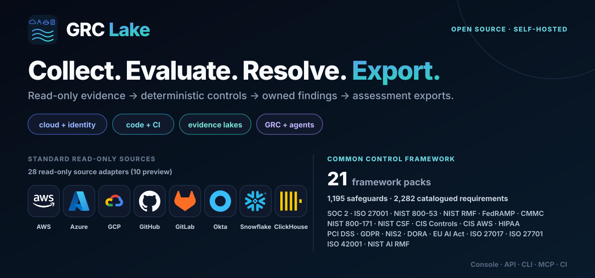
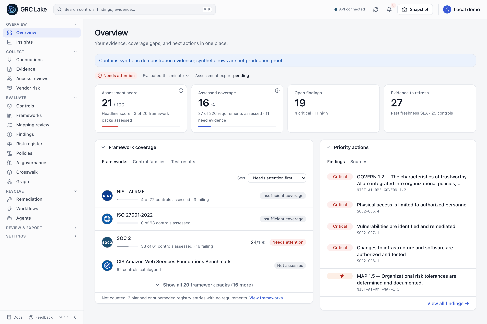
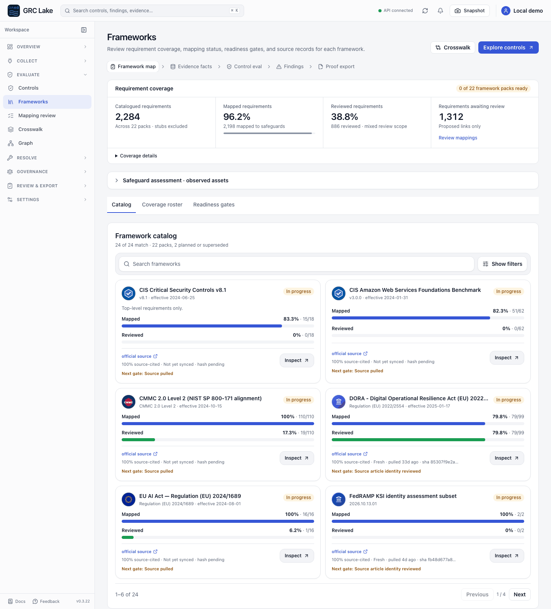
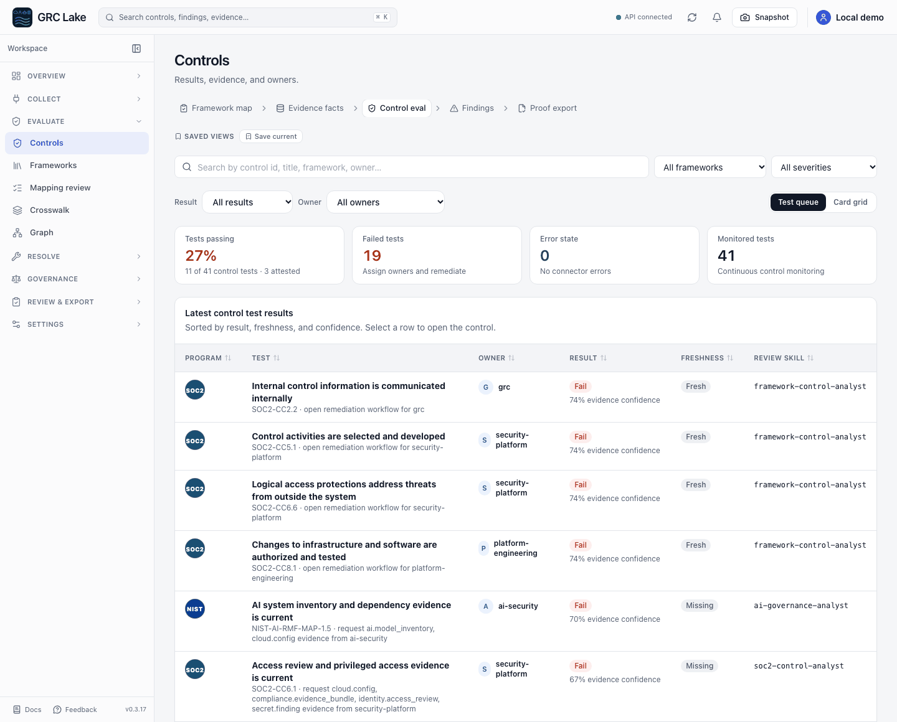
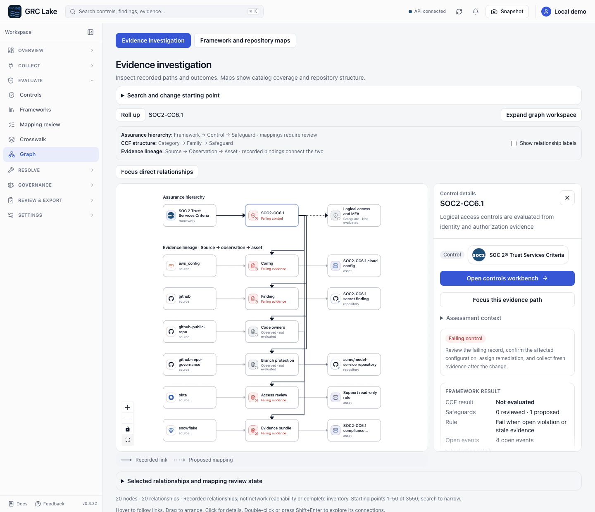
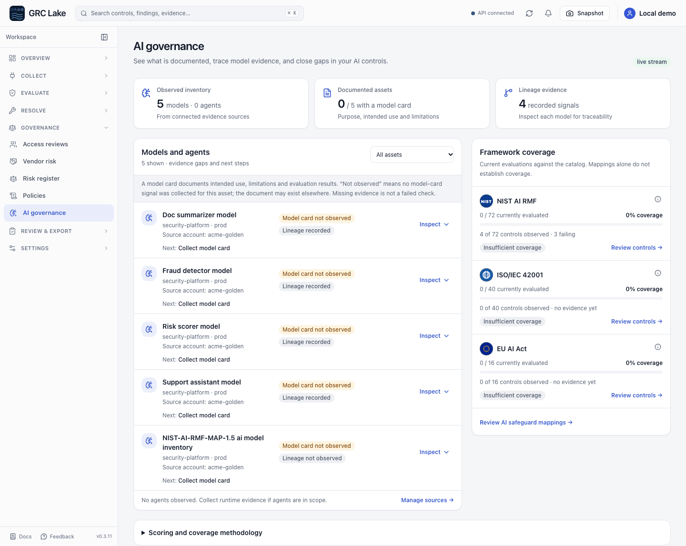
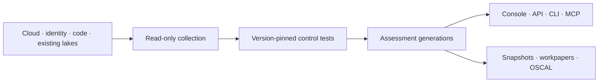

<p align="center">
  

</p>

<p align="center">
  <a href="https://pypi.org/project/grc-lake/"></a>
  <a href="https://pypi.org/project/grc-lake/"></a>
  <a href="https://github.com/koda-ai-studio/grc-lake/actions/workflows/ci.yml"></a>
  <a href="LICENSE"></a>
  <a href="https://scorecard.dev/viewer/?uri=github.com/koda-ai-studio/grc-lake"></a>
</p>

**Turn security evidence into traceable control assessments and reviewable audit workpapers.**
GRC Lake is open-source and self-hosted, running in infrastructure you control.
Read evidence from existing systems and security lakes, evaluate versioned rules,
and preserve the evidence and review decisions behind each result.

[Quick start](#quick-start) · [Product tour](#product-tour) · [Self-host](#self-host) ·
[Coverage](docs/CURRENT_STATE.md) · [Documentation](docs/README.md)

## Quick start

The tour and catalog counts describe current source; see [release status](docs/RELEASE_READINESS.md)
for changes since the published package.

Install published v0.3.5 with Python 3.11+ on macOS or Linux:

```bash
python -m venv .venv
source .venv/bin/activate
pip install "grc-lake[server]==0.3.5"
grc-lake fixtures load --company golden --out ./lake --rebase-times
grc-lake serve --server --allow-insecure-no-auth --lake ./lake --host 127.0.0.1 --port 8787
```

Open [localhost:8787/console/dashboard/](http://127.0.0.1:8787/console/dashboard/).
This loopback demo uses synthetic data and disables authentication.
**First task:** find a failing control, inspect its evidence and mapping, then
export the frozen result. Follow the [sample-data tutorial](docs/TUTORIAL_5_MIN.md);
continue with the [synthetic workpaper example](docs/AUDITOR_WALKTHROUGH.md)
to inspect a scoped test plan, population gaps, and a verified export.
Installation time depends on your machine and connection.

<details>
<summary>Docker, source development, or MCP</summary>

The public Docker image needs no registry login. Use the published templates:

```bash
git clone --branch v0.3.5 --depth 1 https://github.com/koda-ai-studio/grc-lake.git
cd grc-lake
docker compose up
```

For current source, with [uv](https://docs.astral.sh/uv/) and Node 22+:

```bash
git clone https://github.com/koda-ai-studio/grc-lake.git
cd grc-lake
uv sync --frozen --extra dev --extra server
make demo-local
```

For MCP over stdio:

```bash
pip install "grc-lake[mcp]==0.3.5"
GRC_LAKE_LAKE=./lake grc-lake-mcp
```

See [headless GRC](docs/HEADLESS_GRC.md) for agent credentials and authority.

</details>

## Product tour

**Collect → Evaluate → Resolve → Export.** Read source evidence, run version-pinned
control tests, investigate findings, and export a scoped assessment.

### Start with the assessment overview

See assessed coverage, open findings, evidence freshness, and priority actions
together. Framework posture distinguishes assessed results from requirements
that still need evidence.

<picture>
  <source media="(prefers-color-scheme: dark)" srcset="docs/images/grc-lake-demo-dashboard-dark.png">
  
</picture>

### Explore framework coverage

Browse framework packs and their requirements, compare mapped and reviewed
coverage, and open the controls or mappings that need attention. Catalogued,
mapped, reviewed, and assessed requirements remain separate measures.

<picture>
  <source media="(prefers-color-scheme: dark)" srcset="docs/images/grc-lake-demo-frameworks-dark.png">
  
</picture>

### Inspect control results and evidence

Filter the control worklist by result, owner, or framework. Open a control to
inspect its evidence, findings, freshness, and test confidence.

<picture>
  <source media="(prefers-color-scheme: dark)" srcset="docs/images/grc-lake-demo-controls-dark.png">
  
</picture>

### Navigate control families and the CCF

The Common Control Framework (CCF) organizes reusable safeguards into categories
and control families. Explore their links to framework requirements and see
reviewed and proposed mappings separately. Proposed mappings are not attestable.

[How common safeguards work](docs/COMMON_CONTROL_FRAMEWORK.md).

### Trace a finding through the evidence graph

Follow exact records between controls, safeguards, evidence, repositories, and
assets. Select a node to inspect it; drill into its connections or roll up to the
previous view. Depth and layer controls keep the investigation focused.

<picture>
  <source media="(prefers-color-scheme: dark)" srcset="docs/images/grc-lake-demo-graph-dark.png">
  
</picture>

### Review AI assets and their next actions

The model and agent worklist brings owners, environments, governance signals,
and next actions together. Open an asset's linked controls or filtered evidence;
recorded lineage remains distinct from freshly evaluated controls.

<picture>
  <source media="(prefers-color-scheme: dark)" srcset="docs/images/grc-lake-demo-ai-governance-dark.png">
  
</picture>

_Screens use the bundled synthetic company, captured for v0.3.3 from source
`27b21b16` on 2026-10-12. They show recorded relationships and demo workflows,
not a customer deployment or an audit opinion._

[Try the five-minute console tour](docs/PRODUCT_WALKTHROUGH.md#five-minute-tour) ·
[How evidence investigation works](docs/INVESTIGATION_GRAPH.md)

## Architecture

Read-only collection feeds deterministic evaluation. Each published assessment
retains verified artifact hashes; snapshots form a hash-chained ledger.
Console, REST API, CLI, and MCP expose the same evidence and assessment model.



Use [direct connectors](docs/CONNECTOR_CREDENTIALS.md) or
[read an existing lake](docs/BRING_YOUR_OWN_LAKE.md). Both materialize assessment
evidence into storage you operate. Reader compatibility, schema mapping, and
live qualification vary; check the [connector catalog](connectors/catalog.json).

Queued assessments retain tenant-scoped result receipts. Pagination, queue
admission, response storage, and retries have explicit bounds. See the
[assessment contract](docs/ASSESSMENT_APPLICATION_CONTRACT.md) and
[architecture guide](docs/ARCHITECTURE.md) for recovery behavior and API limits.

## Self-host

Deploy with [Docker or Helm](deploy/README.md) on your infrastructure:

- **Local:** one writable replica with a filesystem lake.
- **Distributed:** API replicas and tenant workers share PostgreSQL and
  S3-compatible storage. CLI assessments use a filesystem lake; MCP uses the
  authenticated API for distributed deployments.
- **Production:** configure [SSO and scoped credentials](docs/SERVER_AUTH.md),
  [retention](docs/OPERATIONS_CONTRACTS.md), and [backup/restore](docs/runbooks/BACKUP_RESTORE.md).

See [deployment compatibility](docs/DEPLOYMENT.md#deployment-and-lake-compatibility)
and the [distributed guide](docs/DISTRIBUTED.md). Production capacity and provider
failover require deployment-specific qualification.

Release packages include signed provenance and an SBOM. Follow
[artifact verification](docs/RELEASE_READINESS.md#release-gates).
Upgrading from TrustOps? Read the [migration guide](docs/REBRANDING.md).

## Frameworks

<!-- BEGIN README AT A GLANCE -->

- **20 framework packs, 2,252 catalogued requirements (1,965 distinct; FedRAMP Moderate's 287 rows restate NIST SP 800-53 controls),** linked through 516 safeguards, including source-native assessment contracts. 1,803 requirements have safeguard mappings; 1,128 have reviewed mappings and the other 675 are proposed.
- **25 read-only source adapters (7 in preview)**, plus OCSF presets for existing security lakes.
- **Evidence stays scoped:** missing or stale evidence leaves gaps; a passing sample does not prove complete population coverage. Proposed mappings are not attestable.
- **One engine, four surfaces:** console, REST API, CLI, and MCP server. Agents propose; humans approve.

<!-- END README AT A GLANCE -->

Catalog counts above are generated from source. Reviewed counts record maintainer
mapping decisions; see the [review method and limits](docs/COMMON_CONTROL_FRAMEWORK.md#maintainer-source-batch-review).
Mapping-review decisions do not change access at a provider.

[Framework coverage](docs/FRAMEWORK_COVERAGE.md) ·
[Common safeguards](docs/COMMON_CONTROL_FRAMEWORK.md) ·
[Qualification and test coverage](docs/CURRENT_STATE.md)

Fixture tests and screenshots do not establish live-provider accuracy,
production capacity, or certification. See [audit readiness](docs/AUDIT_READINESS.md)
for qualification boundaries and [the roadmap](ROADMAP.md) for remaining gaps.

## Documentation

| Task                 | Guide                                                                                            |
| -------------------- | ------------------------------------------------------------------------------------------------ |
| Try the console      | [Product walkthrough](docs/PRODUCT_WALKTHROUGH.md)                                               |
| Connect evidence     | [Connector setup](docs/CONNECTOR_CREDENTIALS.md) · [Existing lakes](docs/BRING_YOUR_OWN_LAKE.md) |
| Integrate an agent   | [Headless GRC](docs/HEADLESS_GRC.md) · [Agent API](docs/api/AGENT_API.md)                        |
| Operate a deployment | [Deployment](docs/DEPLOYMENT.md) · [Operations](docs/OPERATIONS_CONTRACTS.md)                    |
| Contribute           | [Contributing](CONTRIBUTING.md) · [Security](SECURITY.md)                                        |

[All documentation](docs/README.md). Regenerate the header and counts with
`make readme-header`; capture demo screens with `make demo-screenshots-full`.
License: [Apache 2.0](LICENSE).
