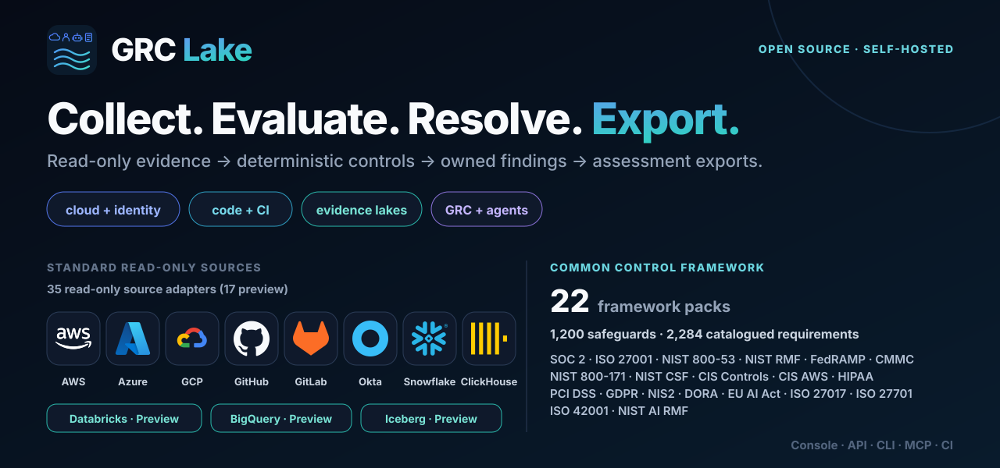
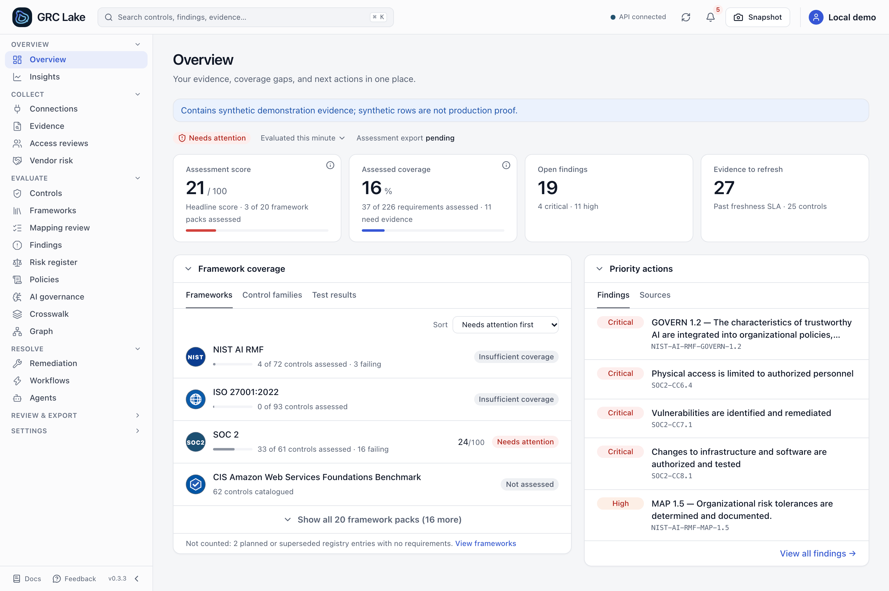
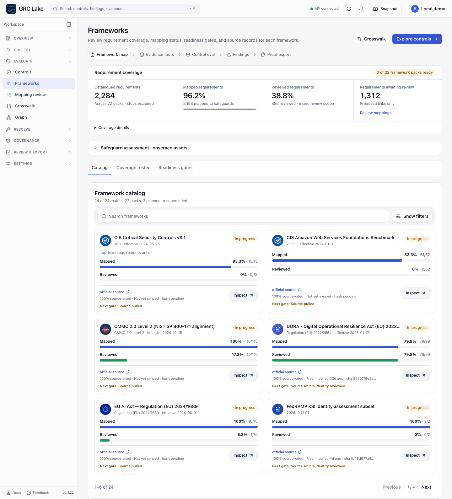
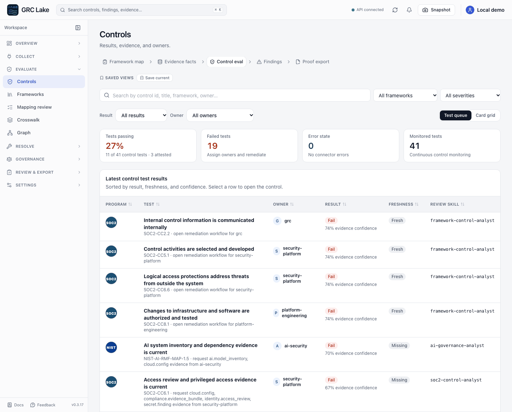
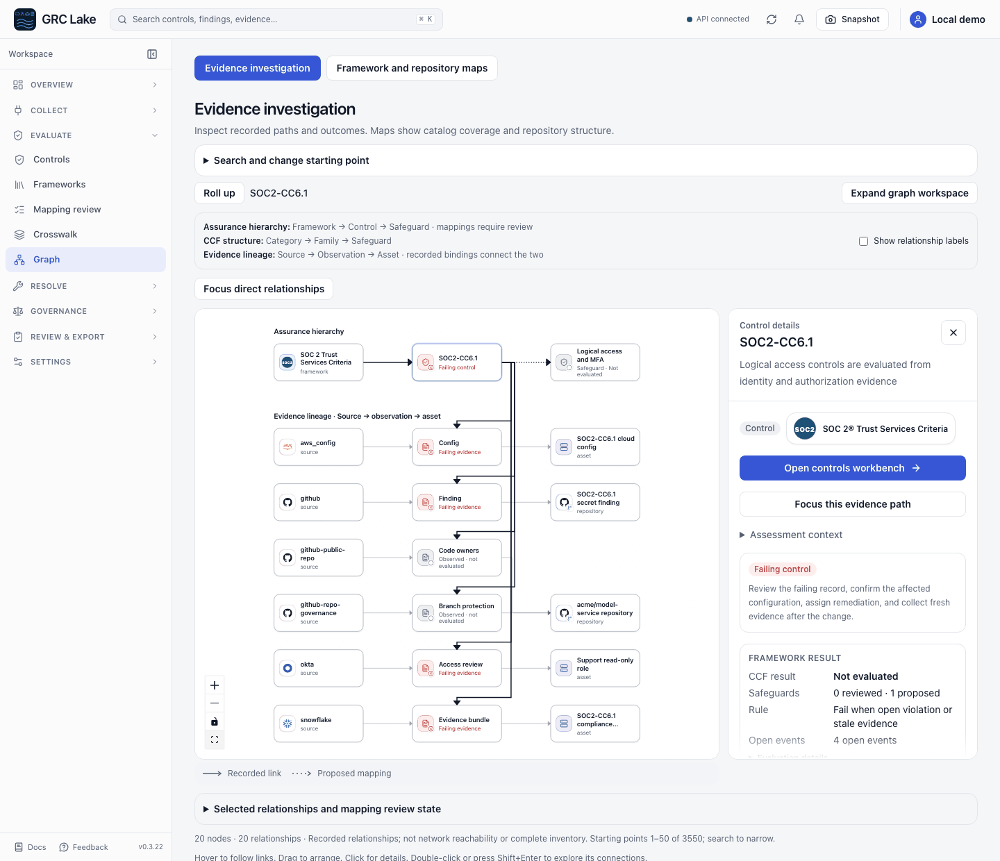
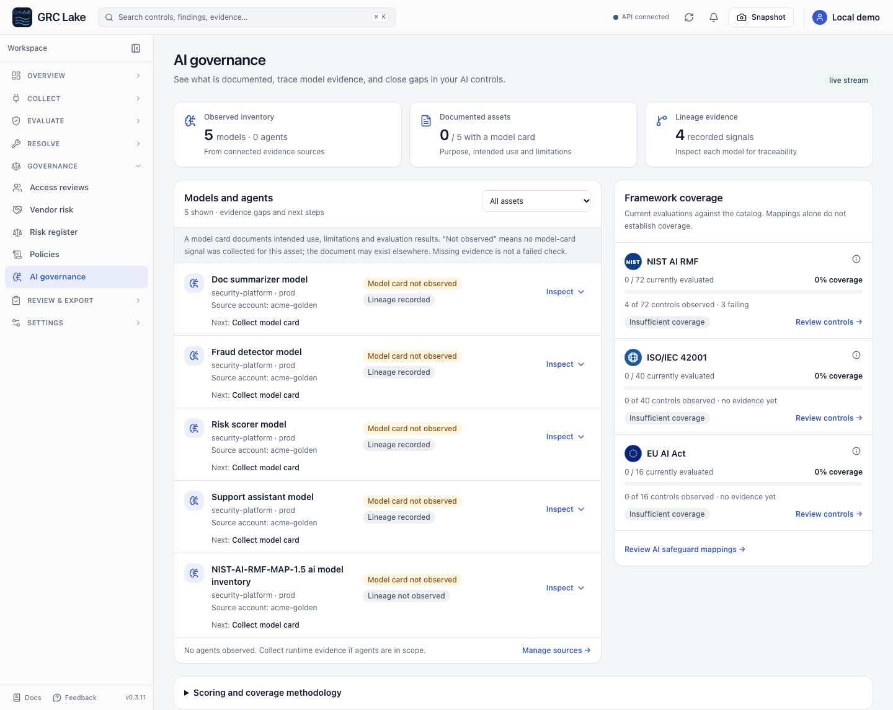
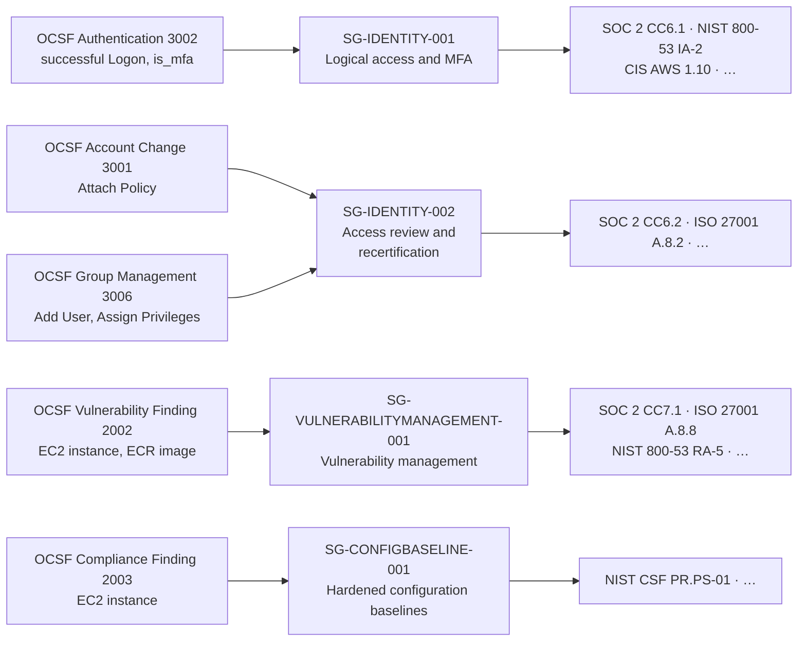

<p align="center">
  <picture>
  <source media="(max-width: 640px)" srcset="docs/images/grc-lake-capability-header-mobile.svg">
  
  </picture>

</p>

<p align="center">
  <a href="https://pypi.org/project/grc-lake/"></a>
  <a href="https://pypi.org/project/grc-lake/"></a>
  <a href="https://github.com/koda-ai-studio/grc-lake/actions/workflows/ci.yml"></a>
  <a href="LICENSE"></a>
  <a href="https://scorecard.dev/viewer/?uri=github.com/koda-ai-studio/grc-lake"></a>
  <a href="https://www.bestpractices.dev/en/projects/15368"></a>
</p>

**Turn security evidence into traceable control assessments and reviewable audit workpapers.**

GRC Lake is open-source and self-hosted. Collect read-only evidence, evaluate
versioned control tests, follow results back to their records, and export
verifiable snapshots and workpapers. The console, API, CLI, and MCP share one model.

**[Try the live demo →](https://koda-ai-studio.github.io/grc-lake/)** — read-only,
recorded synthetic data; no installation or connection to your systems.

[Quick start](#quick-start) · [Product tour](#product-tour) ·
[Self-host](#self-host) · [Connect evidence](#connect-evidence) ·
[Frameworks](#frameworks) · [Documentation](#documentation)

## Quick start

With Python 3.11+ and [uv](https://docs.astral.sh/uv/):

```bash
uvx --from "grc-lake[server]" grc-lake demo
```

Opens the console at [localhost:8787](http://127.0.0.1:8787/console/dashboard/)
with a temporary synthetic lake and **authentication disabled**. Ctrl+C stops the
demo and deletes that lake. For real data, use the [authenticated deployment guide](docs/DEPLOYMENT.md).

**First task:** inspect a failing control, follow its evidence, and export the result.
The [five-minute tutorial](docs/TUTORIAL_5_MIN.md) walks through it. To keep the lake
for the [auditor workpaper example](docs/AUDITOR_WALKTHROUGH.md), add `--lake ./lake`
to the demo command.

<details>
<summary>Other ways to run: pip, Docker, source, MCP, or CI</summary>

**pip:** `pip install "grc-lake[server]"`, then `grc-lake demo`.

**Docker demo** (public image, no registry login):

```bash
git clone --branch v0.3.26 --depth 1 https://github.com/koda-ai-studio/grc-lake.git
cd grc-lake && docker compose up
```

**Source development** requires uv and Node 22+:

```bash
git clone https://github.com/koda-ai-studio/grc-lake.git
cd grc-lake && uv sync --frozen --extra dev --extra server && make demo-local
```

**MCP over stdio:** install `grc-lake[server,mcp]`, then run
`GRC_LAKE_LAKE=./lake grc-lake-mcp`. See [agent credentials and workflows](docs/HEADLESS_GRC.md).

**CI:** post a framework-readiness summary or gate a merge with the
[readiness action](docs/CI_GATE.md#readiness-summary-action):

```yaml
- uses: koda-ai-studio/grc-lake@v0.3.26
  with:
    grc-lake-url: ${{ secrets.GRC_LAKE_URL }}
    api-token: ${{ secrets.GRC_LAKE_API_TOKEN }}
```

</details>

## Product tour

**Collect → Evaluate → Resolve → Export.** Start with assessment coverage, findings,
evidence freshness, and priority actions. These captures use the
bundled synthetic company, refreshed for the 0.3.24 release candidate; they are not live-provider proof.

<picture>
  <source media="(prefers-color-scheme: dark)" srcset="docs/images/grc-lake-demo-dashboard-dark.png">
  
</picture>

<details>
<summary>Explore frameworks, controls, the evidence graph, and AI assets</summary>

### Explore framework coverage

Catalogued, mapped, reviewed, and assessed requirements are separate measures.

<picture>
  <source media="(prefers-color-scheme: dark)" srcset="docs/images/grc-lake-demo-frameworks-dark.png">
  
</picture>

### Inspect control results and evidence

Filter by owner or framework; inspect each control's evidence, findings, and freshness.

<picture>
  <source media="(prefers-color-scheme: dark)" srcset="docs/images/grc-lake-demo-controls-dark.png">
  
</picture>

### Navigate control families and the CCF

The Common Control Framework organizes **category → family → safeguard**.
The IAM category includes the Access review family and `SG-IDENTITY-002`
(access review and recertification). `SG-…` IDs are stable GRC Lake identifiers,
not official framework control numbers. Proposed mappings are not attestable.

### Trace a finding through the evidence graph

Follow recorded links between requirements, safeguards, evidence, and assets.
Inspect the exact source account, binding validity, outcome, and next action;
use Whole graph for context or Readable view for labels and panning.

<picture>
  <source media="(prefers-color-scheme: dark)" srcset="docs/images/grc-lake-demo-graph-dark.png">
  
</picture>

[Full-size graph: light](docs/images/grc-lake-demo-graph.png) ·
[dark](docs/images/grc-lake-demo-graph-dark.png) · [Graph guide](docs/INVESTIGATION_GRAPH.md)

### Review AI assets and their next actions

Models and agents carry owners, environments, and governance signals.
Recorded lineage shows evidence presence, not a passing control.

<picture>
  <source media="(prefers-color-scheme: dark)" srcset="docs/images/grc-lake-demo-ai-governance-dark.png">
  
</picture>

[Console walkthrough](docs/PRODUCT_WALKTHROUGH.md#five-minute-tour) ·
[AI discovery walkthrough](docs/AI_DISCOVERY_WALKTHROUGH.md)

</details>

## Architecture

Read-only collection → version-pinned evaluation → assessment generations →
review and export. Snapshots form a hash-chained ledger you can re-verify.

[Architecture and source map](docs/ARCHITECTURE.md#implementation-and-test-map) ·
[Assessment contract](docs/ASSESSMENT_APPLICATION_CONTRACT.md) ·
[CCF/OSCAL exports](docs/OSCAL_EXPORT.md#portable-ccf-and-framework-bundle)

## Connect evidence

Connect cloud, identity, endpoint, code, people, and workflow systems, or read
existing security lakes. Start with [connector setup](docs/CONNECTOR_CREDENTIALS.md);
check each adapter's stage, permissions, and receipts in the
[qualification matrix](docs/CONNECTOR_QUALIFICATION.md) and [connector catalog](connectors/catalog.json).

For a real evaluation, use the [bounded pilot guide](docs/PILOT.md): one source,
one independently checked result, then repeat collection and review.

### Already on OCSF?

Keep your existing ingestion pipeline. GRC Lake can run read-only queries against
OCSF tables, retain a mapped copy, and evaluate imported rows. See
[existing-lake setup and OCSF presets](docs/BRING_YOUR_OWN_LAKE.md#ocsf-events-in-the-common-control-framework)
for supported stores, commands, and limits.

<details>
<summary>Example OCSF → safeguard → framework relationships</summary>

These are example crosswalk links, not a claim that every mapping is reviewed.
Rules conclude only what each event supports; missing review or evidence blocks a pass.



</details>

## Frameworks

A catalogued requirement, a reviewed mapping, and an assessed result are different.
Safeguards are reusable across frameworks; a passing control test alone does not
establish framework attestation.

[Per-framework coverage](docs/FRAMEWORK_COVERAGE.md) ·
[Common safeguards](docs/COMMON_CONTROL_FRAMEWORK.md) ·
[Audit-readiness gates](docs/AUDIT_READINESS.md#explain-the-readiness-decision)

<details>
<summary>Generated catalog and mapping-review counts</summary>

<!-- BEGIN README AT A GLANCE -->

- **Reviewed requirements by framework:** SOC 2 49/61, ISO 27001 43/93, HIPAA 0/24, PCI DSS 0/12 (top-level), NIST CSF 2.0 72/106, NIST SP 800-53 399/1,014 (381 source-native self-maps). Every pack is in the [coverage matrix](docs/FRAMEWORK_COVERAGE.md).
- **22 framework packs, 2,284 catalogued requirements (1,997 distinct; FedRAMP Moderate's 287 rows restate NIST SP 800-53 controls),** linked through 1,200 safeguards, including source-native assessment contracts. 2,198 requirements have safeguard mappings; 886 have reviewed mappings and the other 1,312 are proposed. Of the reviewed, 381 are source-native self-maps (written from that requirement's own pinned source) and 505 rest on reviewed crosswalk mappings; 0 rest only on legacy reviews with no recorded reviewer. The blended total is not a per-framework readiness figure. Every reviewed mapping names one maintainer reviewer across 3 review receipts; no independent second review is recorded yet ([review method](docs/MAPPING_REVIEW.md)).
- **35 executable adapters (18 implemented, 17 preview) and 3 configuration boundaries**. Read-only provider collection includes OCSF presets for existing security lakes.
- **Evidence stays scoped:** missing or stale evidence leaves gaps; a passing sample does not prove complete population coverage. Proposed mappings are not attestable.
- **One engine, four surfaces:** console, REST API, CLI, and MCP server. Agents propose; humans approve.

<!-- END README AT A GLANCE -->

</details>

## Self-host

Use [Docker or Helm](deploy/README.md) on infrastructure you control. The
[deployment guide](docs/DEPLOYMENT.md) covers authenticated first-admin setup,
TLS, and storage choices.

| Deployment    | Operating model                                                                                                             |
| ------------- | --------------------------------------------------------------------------------------------------------------------------- |
| Local storage | One writable replica and a persistent filesystem lake                                                                       |
| Distributed   | API replicas and tenant workers with PostgreSQL and S3-compatible storage; see the [distributed guide](docs/DISTRIBUTED.md) |

Before real use, configure [SSO and scoped credentials](docs/SERVER_AUTH.md),
[retention](docs/OPERATIONS_CONTRACTS.md), and [backup/restore](docs/runbooks/BACKUP_RESTORE.md).
Check [release verification and artifact provenance](docs/RELEASE_READINESS.md)
for the version you deploy; source changes may precede a published release.

<a id="performance-and-qualification"></a>

<details>
<summary>Performance, qualification, and evidence limits</summary>

The [accepted local graph profile](docs/benchmarks/RELEASE_PROFILE.md) covers two
tenants with up to 10k synthetic records each and four concurrent clients.
It measures authenticated depth-one reads on local SQLite, not browser rendering,
100k interactive use, external storage, or production sizing.

Bounded live receipts include an [AWS/GitHub pilot](docs/qualification/live/2026-10-26-aws-github-binding.md)
and a [populated Databricks audit log](docs/qualification/live/2026-10-25-databricks.md#databricks-populated-audit).
Each covers one account or workspace, not provider-wide qualification.

Synthetic tests and demos do not establish live-provider accuracy, certification,
or an audit opinion. [Current state](docs/CURRENT_STATE.md) and the [roadmap](ROADMAP.md)
record remaining gaps.

</details>

<a id="engineering-review"></a>

## Documentation

| Task                                       | Start here                                                                                                               |
| ------------------------------------------ | ------------------------------------------------------------------------------------------------------------------------ |
| Understand pass, fail, and unknown results | [Evaluation semantics](docs/EVIDENCE_EVALUATION_SEMANTICS.md) · [Population coverage](docs/POPULATION_RECONCILIATION.md) |
| Inspect a complete control workflow        | [Synthetic workpaper qualification](docs/CONTROL_WORKFLOW_QUALIFICATION.md)                                              |
| Review isolation and authorization         | [Threat model](docs/THREAT_MODEL.md)                                                                                     |
| Upgrade or troubleshoot                    | [Changelog](CHANGELOG.md) · [Operations](docs/OPERATIONS_CONTRACTS.md) · [TrustOps migration](docs/REBRANDING.md)        |
| Contribute or report a problem             | [Contributing](CONTRIBUTING.md) · [Security](SECURITY.md)                                                                |

[All documentation](docs/README.md) · License: [Apache 2.0](LICENSE)

<!-- mcp-name: io.github.koda-ai-studio/grc-lake -->
