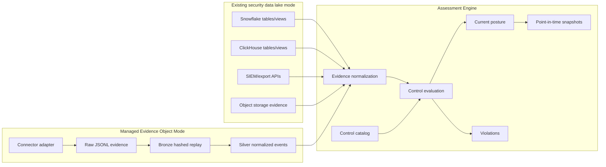

# Data Flow

The product is assessment-first. Data can arrive from an existing security data
lake or from GRC Lake-managed connector outputs. GRC Lake can run on-premises or
in the cloud. Its application storage is a filesystem lake in local mode, or
PostgreSQL plus S3-compatible object storage in distributed mode. This choice is
independent of the source lake; see the [compatibility matrix](DEPLOYMENT.md#deployment-and-lake-compatibility).

For the production operating loop that turns this data flow into continuous
collection, evaluation, snapshots, and API access, see
[`CONTINUOUS_INGESTION.md`](CONTINUOUS_INGESTION.md).

## Two Connection Modes



## Existing security data lake mode

Use this when evidence already exists in a supported Snowflake, ClickHouse,
Databricks, BigQuery, Iceberg/Parquet, object-storage or SIEM source. Reader preview
status and experimental mappings are documented in [bring your own lake](BRING_YOUR_OWN_LAKE.md).

The reader connects with read-only access, maps selected rows into the canonical
evidence schema, and persists those observations in GRC Lake's assessment storage.
The evaluation process produces normalized evidence, control results, findings
and snapshots there. The source system remains unchanged; selected evidence is
copied into the assessment store. Control evaluation does not execute inside the
source warehouse.

## Managed Evidence Object Mode

Use this when the company does not have a clean security data model yet.

The tool creates:

- raw evidence files or landing tables
- bronze hashed replay records
- silver normalized evidence facts
- gold control posture, asset risk, current posture, and snapshots
- optional Snowflake and ClickHouse tables/views

The bundled sample starts from `data/raw/security_events.jsonl`. Production
connectors use the same evidence contract. Distributed workers publish their
artifacts to S3 and commit the authoritative manifest in PostgreSQL; see
[distributed publication](DISTRIBUTED.md#publication-and-failure-behavior).

The normalization handoff is explicit and reusable for pre-landed canonical raw
evidence:

```bash
grc-lake ingestion normalize \
  --raw ./raw/connector_events.jsonl \
  --out ./lake
```

Use `--incremental` for replay-safe updates when the output lake already has a
manifest. Direct connectors use the same normalization boundary after they land
raw evidence; existing Snowflake, ClickHouse, object-storage, and SIEM sources
must first be mapped by their source adapter into the canonical raw contract.

## Evaluation Steps

```text
source evidence
  -> normalize into canonical evidence facts
  -> join evidence to control mappings
  -> evaluate pass/fail/stale/missing evidence
  -> emit violations with owner, asset, evidence_ref, raw_sha256
  -> compute framework scores and current posture
  -> optionally freeze a point-in-time snapshot
```

## Current Implementation

| Step              | Current artifact                                                   |
| ----------------- | ------------------------------------------------------------------ |
| Source evidence   | `data/raw/security_events.jsonl`                                   |
| Validation        | `src/security_lakehouse/validation.py`                             |
| Normalization     | `src/security_lakehouse/pipeline.py`                               |
| Control mapping   | `mappings/control_map.json`                                        |
| Assessment engine | `src/security_lakehouse/assessment.py`                             |
| Current posture   | `build/lakehouse/gold/current_posture.json`                        |
| Violations        | `grc-lake assessment violations --lake build/lakehouse`            |
| Snapshot          | `grc-lake assessment snapshot --lake build/lakehouse --reason ...` |
| API               | `src/security_lakehouse/server_app.py`                             |

## Connector Contract

Connectors should emit evidence records with:

- `event_id`
- `tenant_id`
- `event_time`
- `source`
- `event_type`
- `entity.asset_id`
- `entity.asset_type`
- `severity`
- `status`
- `controls`
- `evidence.evidence_id`
- `evidence.evidence_ref`
- `evidence.evidence_collected_at`
- `evidence.raw_sha256`

Optionally, `entity.asset_name` gives the asset a human-readable name. It is
display data only: `asset_id` stays the key everywhere. The name is kept on the
gold asset rows (`gold/asset_risk.jsonl`), not on normalized events, and the
API adds it as `asset_name` to evidence, violations, assets, AI inventory, and
graph asset labels.

Connectors should not decide compliance. They only collect evidence. The
assessment engine decides posture.

## Evaluation Contract

Controls evaluate from:

- normalized evidence facts
- control mapping metadata
- freshness window
- status/severity rules
- owner and asset context

[Governed exceptions](GOVERNED_REMEDIATION.md) record independently approved,
time-limited risk acceptance alongside results. They do not change a failed
control to `pass`, supply missing evidence, or remove the original finding.

Outputs:

- current posture
- framework scores
- control status
- open violations
- stale controls
- top risk assets
- assessment snapshots
