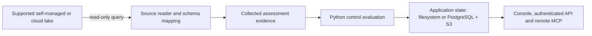

# Supported evidence lakes

GRC Lake can run on-premises or in the cloud and read evidence from a separately
operated lake. Source readers, application storage and optional result exports
have different contracts; see the [deployment and lake compatibility matrix](DEPLOYMENT.md#deployment-and-lake-compatibility).

## Read-only source matrix

| Source                           | Implemented reader                                                                   | Current qualification boundary                                                               |
| -------------------------------- | ------------------------------------------------------------------------------------ | -------------------------------------------------------------------------------------------- |
| Snowflake                        | GRC Lake evidence views, or existing tables through mappings                         | Standard catalog entry; mapped-table mode is experimental and fixture-tested                 |
| ClickHouse                       | `normalized_events`, or existing tables through mappings                             | Standard catalog entry; mapped-table mode is experimental and fixture-tested                 |
| Databricks                       | Unity Catalog evidence views or mapped tables through a SQL warehouse                | Preview; fixture and fake Statement Execution API tests; live workspace verification pending |
| Iceberg / Parquet                | Supported Glue or Iceberg REST catalog paths, or Parquet datasets, with OCSF presets | Preview; local-table and recorded-query qualification; live provider verification pending    |
| BigQuery                         | Configured tables and parameterized mapped reads with a bytes-billed limit           | Preview; fixture/recorded-query qualification; live project verification pending             |
| Object-storage and SIEM evidence | Supported objects and export/API shapes                                              | Separate adapters; source-specific credentials, formats and collection limits apply          |

A standard catalog entry is an implementation label, not proof of a live run in
a customer's account. Preview status is retained until the required live checks
are completed. Mapping mode is experimental; consult [bring your own lake](BRING_YOUR_OWN_LAKE.md)
and [connector setup](CONNECTORS.md) before selecting a source.

Mapped readers check for a row beyond the configured per-mapping budget. If one
exists, collection is partial: sampled passes are withheld, the prior cursor is
held, and the run exposes a `row_limit_exceeded` gap. Operators must resize or
explicitly partition the read scope and replay it. This protects assessment
accuracy when a security lake contains more evidence than a bounded read can
cover; it does not establish full lake coverage or qualify production scale.
See [bounded reads and recovery](BRING_YOUR_OWN_LAKE.md#incremental-reads-and-write-mode).

## Where evidence and results live

Readers preserve the source system but copy selected rows into GRC Lake's
assessment storage for normalization, evaluation and retained generations. A
read-only query does not imply that evidence never leaves the source workspace.
Control tests execute in the application's Python process, not inside a warehouse.
Distributed mode shares state across API replicas and tenant workers; it does not
make one tenant evaluation a distributed warehouse query.

## Customer ingestion and warehouse features

Operators may already use streaming ingestion, batch loaders, materialized views,
retention policies or open-table catalogs in their source lake. Those upstream
facilities are owned by the operator. The GRC Lake read-only source connector does
not provision them, create warehouse objects, or require DDL privileges.

Reference schemas are available for [Snowflake](../deploy/snowflake/schema.sql),
[ClickHouse](../deploy/clickhouse/schema.sql), and the
[Databricks POC](../deploy/databricks/bootstrap_poc.sql). Schema artifacts describe
expected shapes; they do not establish a live deployment or scale result.

## Optional result exports

| Sink       | Supported path                                                       | Boundary                                                                        |
| ---------- | -------------------------------------------------------------------- | ------------------------------------------------------------------------------- |
| Snowflake  | Export the committed normalized/gold generation to configured tables | Operator-owned filesystem run; separate write credentials and destination setup |
| ClickHouse | Export the committed generation to configured sink tables            | Operator-owned filesystem run; separate from the read-only source connector     |
| DuckDB     | Export to the configured embedded database file                      | Local analytical projection; does not remove Python evaluation memory limits    |

Server-mode export is rejected until tenant-scoped destination support exists.
An export failure does not undo an already committed assessment; callers receive
separate assessment and export outcomes. These sinks do not implement a general
workflow audit-writeback service or move the canonical assessment into a warehouse.
See [assessment ownership](ARCHITECTURE.md#assessment-ownership-and-export-boundary)
and [scale limits](AUDIT_SCALE.md).
