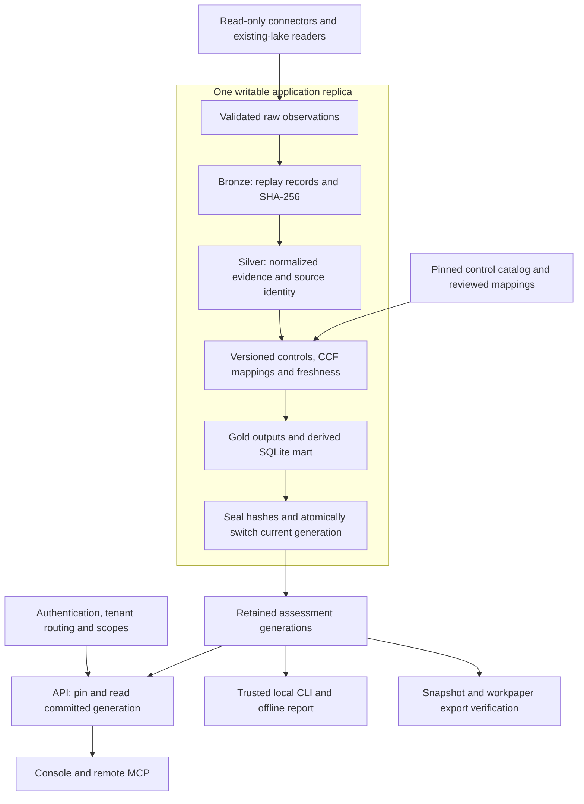

# Architecture — Local (file-backed) mode

This diagram shows the file-backed assessment pipeline. The same engine can run
from the CLI or behind the authenticated API and bundled console.

- **Local mode:** JSONL Bronze/Silver/Gold zones, a SQLite analytics mart, and an
  optional DuckDB mart. One writable application replica owns each lake.
- **Distributed mode:** multiple API replicas and tenant workers use private
  scratch storage, PostgreSQL coordination, and S3-compatible evidence objects.
  See [deployment models](deployment-models.md) and [distributed mode](../DISTRIBUTED.md).
- **Warehouse adapters:** Snowflake and ClickHouse are optional evidence sources
  or export destinations. They are separate from the application topology; see
  [dual lakehouse](dual-lakehouse.md).

## Why This Design

The local pipeline can be inspected with synthetic inputs without a cloud account:

- raw records remain replayable and hash-linked
- transformations are deterministic and testable
- control mappings are separated from source ingestion
- metrics and dashboards are generated from gold data, not hand-written
- SQL access is available through a local mart
