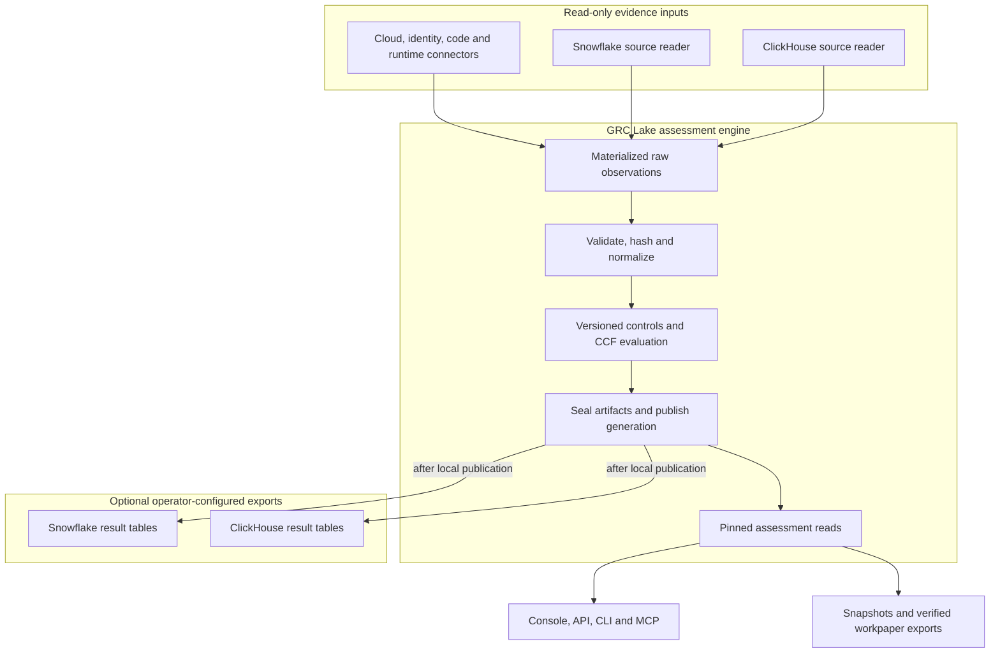

# Warehouse sources and export destinations

Snowflake and ClickHouse are optional integration boundaries. Evaluation runs in
GRC Lake; these adapters do not move control decisions into warehouse SQL or
replace the operational database and committed generation store.

Source credentials authorize reads. Destination credentials authorize the
explicit export. The source and destination can be different systems; configuring
a reader does not authorize writing back to it. Result-table exports are
projections, not in-warehouse evaluation pipelines.

Publication and warehouse export have separate outcomes. A failed export does
not roll back an already committed local assessment, and there is no transaction
across the application and the destination warehouse. Process-configured sinks
are restricted to local operator runs; hosted execution does not inherit them.

For application storage, use [filesystem or distributed deployment](deployment-models.md).
For reader formats and qualification, see [bring your own lake](../BRING_YOUR_OWN_LAKE.md).
For sink authority and failure handling, see the
[assessment export boundary](../ARCHITECTURE.md#assessment-ownership-and-export-boundary).
