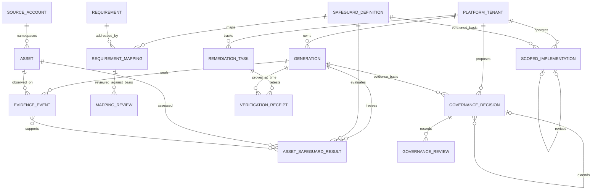

# Unified data model

Logical relationships across a platform-owned lake and its application database.
Catalog and evidence links are verified references, not SQL foreign keys.

`ASSET` has the composite logical key `(source_account_id, asset_id)` within a
platform tenant's lake. Evidence's legacy `tenant_id` means source account;
application records and the generation manifest's `tenant_id` mean platform owner.
One source account can supply evidence to separately authorized deployments; its
identifier alone is never an authorization boundary.

| Layer                           | Storage                                                  | Authority                                                            |
| ------------------------------- | -------------------------------------------------------- | -------------------------------------------------------------------- |
| Evidence and assessment         | Sealed generation: bronze, silver, gold, pinned catalogs | Deterministic evaluation over observed scope                         |
| Indexed reads                   | SQLite mart in the same generation                       | Derived projection, rebuilt from assessment                          |
| Mapping decisions               | Tenant lake's verified review ledger                     | Attributable mapping review, not effectiveness                       |
| Scoped operations and decisions | Tenant-scoped server SQLite/PostgreSQL                   | Human declarations and independent reviews, not verdict overrides    |
| Auth and workflows              | Server database                                          | Tenant membership, keys, sessions, remediation, risk and agent state |
| Snapshots                       | Snapshot artifacts and hash-chained ledger               | Point-in-time assessment history                                     |

A governance decision retains its content, scope, evidence references, catalog
basis and reviewer history. Extensions create new proposals; only approval
supersedes an earlier decision. Expiry, revocation or changed definitions make an
approved decision inactive. None of these records convert a failing or unknown
assessment to passing.

See [data model](../DATA_MODEL.md), [architecture](../ARCHITECTURE.md),
[CCF reads](../CCF_READS.md), and [governance](../GOVERNED_REMEDIATION.md).
